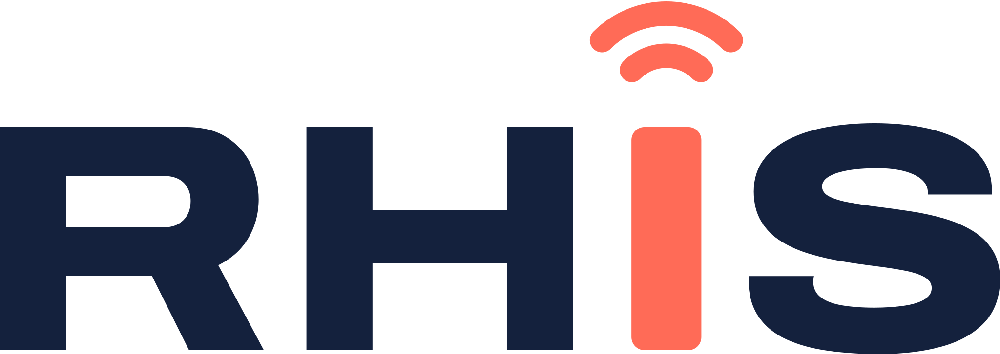

# RHIS

RHIS ontwerpt, installeert en beheert UniFi-netwerken en wifi voor bedrijven en thuis. De huisstijl draait om één beeld: **de I als antenne die signaal uitzendt**. Dat beeld staat in het logo, in het app-icoon en als favicon, en komt terug op de website, in het CRM en op facturen.



## Logo

Het logo is het woordmerk **RHIS** in Archivo Expanded Extra Bold, met de I vervangen door een antenne in koraal. De letters zijn omgezet naar vaste vormen, dus het logo heeft geen lettertype nodig.

| Versie | Gebruik |
| --- | --- |
| `rhis-logo.svg` | Standaard: nacht + koraal op licht (wolk, wit) |
| `rhis-logo-wit.svg` | Op nacht of andere donkere achtergronden |
| `rhis-logo-zwart.svg` | Eén kleur zwart: stempels, fax, gravure |
| `rhis-logo-mono-wit.svg` | Eén kleur wit op foto of donker vlak |
| `rhis-icon.svg` | App-icoon, social avatar: nacht tegel met koraal antenne |
| `rhis-icon-koraal.svg` | Alternatief icoon op donkere achtergronden |
| `rhis-antenne.svg` | Alleen de antenne, als beeldelement of laadindicator |
| `favicon.svg` / `favicon.ico` | Browsertabblad |

**Vrije ruimte:** houd rondom het logo minimaal de breedte van de H vrij.
**Minimale maat:** woordmerk 96 px breed op scherm, 25 mm in druk. Daaronder het icoon gebruiken.

**Niet doen:** de antenne een andere kleur geven dan koraal (behalve in de eenkleurige versies), de letters vervormen of opnieuw zetten in een ander lettertype, schaduwen of verlopen toevoegen, of het UniFi- of Ubiquiti-logo combineren met het RHIS-logo. UniFi noemen we wel in tekst, bijvoorbeeld "UniFi specialist".

## Kleur

Vier merkkleuren. Nacht en wolk dragen het geheel, koraal is het signaal en komt per scherm maar een paar keer voor.

- `nacht` #14213D: letters, donkere vlakken, footer, primaire knoppen op licht.
- `koraal` #FF6B57: de antenne en de belangrijkste call-to-action. Tekst op koraal is altijd `nacht`. Gebruik `accent-text` voor koraalkleurige links op licht, puur koraal haalt daar het contrast niet.
- `lucht` #9CC3FF: steunkleur op nacht, voor pills, grafieken en illustraties.
- `wolk` #F6F7FB: lichte grond.

Voor de applicaties (CRM, facturatie, admin) zijn er status-kleuren: `status-online`, `status-warning` en `status-offline`. Gebruik ze alleen voor status, nooit als decoratie, en altijd met tekst of icoon erbij.

## Typografie

Alles in **Archivo** (Google Fonts, gratis). Koppen in de brede variant: `font-stretch: 125%`, gewicht 800 of 700. Lopende tekst in normale breedte, gewicht 400. Koppen zijn kort en krachtig: één regel waar het kan.

```html
<link href="https://fonts.googleapis.com/css2?family=Archivo:wdth,wght@100..125,400..800&display=swap" rel="stylesheet">
```

## Toon

Nederlands, je en jij, zakelijk maar menselijk. Kort en concreet: wat het oplevert, niet hoe het technisch heet. Voorbeelden: "Wifi die gewoon werkt in elke ruimte." "Je netwerk, op afstand bewaakt." Geen vakjargon zonder uitleg.

## Toepassingen

- **Website:** lichte pagina's op `surface`, hero en footer in `nacht`, één koraal knop per scherm, pill "UniFi specialist" in `lucht` op nacht.
- **Applicaties (CRM, facturatie):** adminmenu links op `surface-raised`, logo bovenaan het menu, Info-knop onderaan met versie en updates.
- **Visitekaartje en facturen:** wit of wolk, logo linksboven, gegevens in `ink-muted`.
